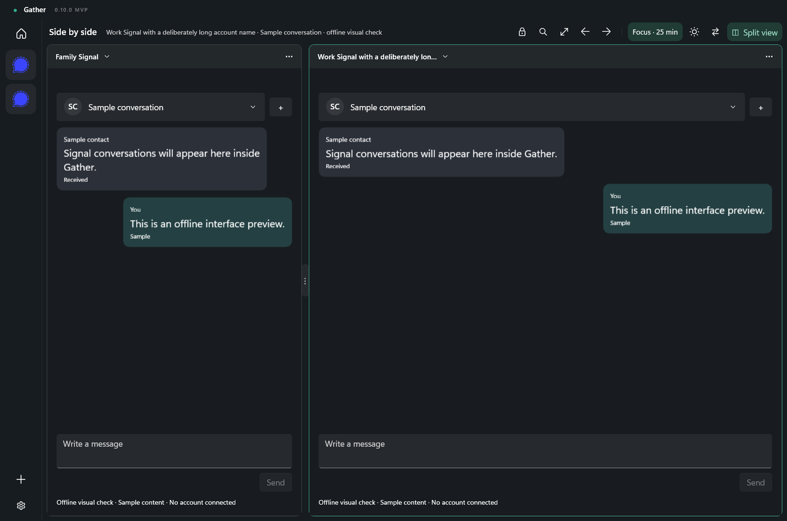
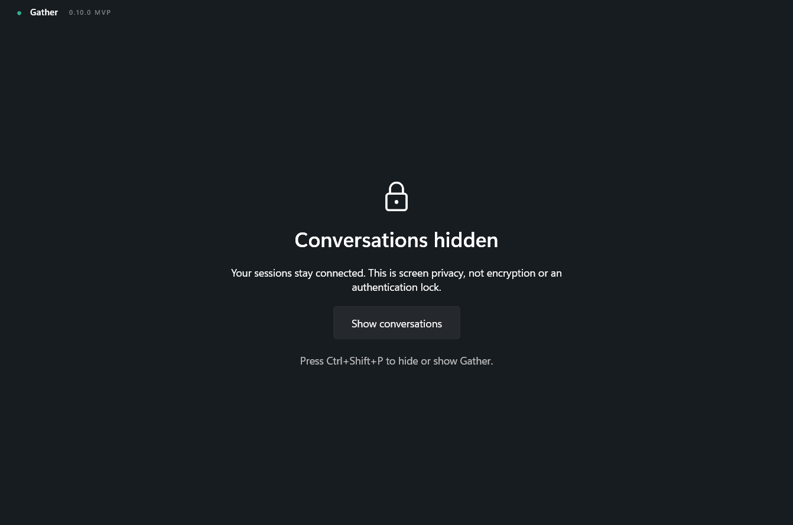

# Gather

Your messaging services, in one Windows app. Keep a conversation in view or open two accounts side by side, with separate profiles for each account.

**[Download for Windows](https://github.com/Housekeeping93/gather/releases/latest)** · [Installation guide](docs/INSTALLATION.md) · [Changelog](CHANGELOG.md)

- **One place for your accounts:** WhatsApp, Telegram, Slack, Messenger, Discord and native Signal text conversations.
- **Single or split view:** resize the divider and switch layouts with **Alt+F**. Find an account with **Ctrl+K**.
- **Room to focus:** compact or comfortable spacing, light/dark themes, focus timers and scheduled quiet hours.
- **Quick screen privacy:** **Ctrl+Shift+P** covers conversations and Gather popups while keeping sessions connected.

## A look inside

| Split view | Privacy curtain |
| --- | --- |
|  |  |

Screenshots use offline sample conversations, with no connected accounts.

Windows 11 x64 and Microsoft Edge WebView2 are required. Signal currently supports text; attachments, calls and older message import are outside the MVP. Messenger and Discord support is experimental.

[Build and verification notes](docs/DEVELOPMENT.md) · [Service and runtime notices](Notices)
